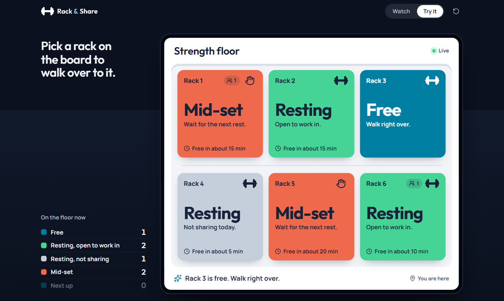
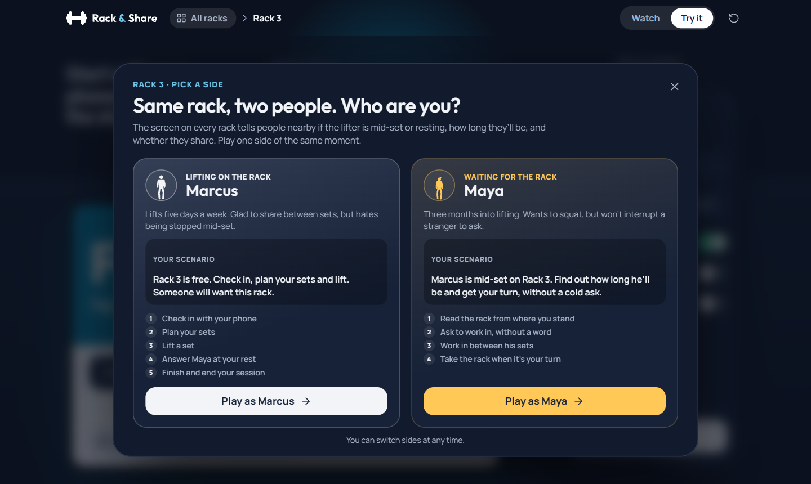

# Rack & Share

An interactive prototype of the Smart Station: a screen on a squat rack, paired with the lifter's phone. The screen tells anyone nearby whether the lifter is mid-set or resting, how long the rack stays busy, and whether they share it.

Live demo: https://yulong-wu-jackson.github.io/rack-and-share/

## The demo



The demo opens on the floor board, a screen by the gym door that shows every rack's station at once. Each tile uses the station's colours: blue for free, red for mid-set, green for resting and open to work in, grey for resting and not sharing. A line at the bottom suggests where a newcomer should go. The other lifters keep running their own workouts, so the board changes while you watch.

Tap a rack and the board zooms into it. Up close the page shows three things at once.

- The gym floor: the rack, the lifter, and a person who wants the rack.
- The station: the screen mounted on the rack.
- The phone: the lifter's app.

"All racks" in the top bar, or Escape, zooms back out to the board. A rack where you started a session waits for you as you left it. Your phone checks in on one rack at a time.

It has two modes.

- Watch plays a story of about 90 seconds. Marcus picks a free rack on the board, checks in and lifts, Maya joins the line without interrupting him, and she later starts her own session without a phone. Each caption draws a ring around the part of the screen it describes, with a line back to the caption. Space pauses, the arrow keys change chapter, and a click on any screen hands control to you.
- Try it lets you play one side of the same moment yourself. The white button beside the rack stands for what happens in the gym: tapping the phone on the rack, lifting the bar, racking it, and working in.

### Try it: pick a side



Tap any rack in Try mode and a picker asks who you are. Both choices set up the same scene on that rack, whatever the board showed.

- Marcus is an experienced lifter. The rack is free: you check in, plan your sets and lift. Maya turns up mid-set, waits for your rest, asks to work in through the rack, and takes the rack when you finish.
- Maya is three months into lifting. Marcus is mid-set: you read the rack, join the line once he rests, work in a set when he says yes, and check in when it is your turn.

The other person is scripted and reacts to what you do. The panel on the left shows who you are, how far you are through the steps, and the next goal, with a line to the control it means. Each person on the gym floor carries a name tag, and the phone is labelled with whose it is. "Switch" plays the other side, and the restart button starts the current side over.

Add `?mode=try` to the URL to open in Try mode, and `&as=marcus` or `&as=maya` to start straight into a side on Rack 3.

## Run it

[mise](https://mise.jdx.dev) installs Node and pnpm and runs every task.

```bash
mise install
mise run install
mise run dev
```

| Task | What it does |
| --- | --- |
| `mise run dev` | Starts the dev server |
| `mise run build` | Type-checks and builds into `dist` |
| `mise run preview` | Serves the production build |
| `mise run check` | Runs lint, type check and tests |
| `mise run format` | Formats and applies safe lint fixes |

## Code layout

| Folder | Contents |
| --- | --- |
| `src/state` | The rack's rules (`model.ts`, with tests) and the app store |
| `src/scenario` | The two Try-mode sides: their steps, the side picker, and the scripted other person (`npc.ts`) |
| `src/floor` | The floor board, the six racks it shows, and the lifters who use them |
| `src/station` | The screen on the rack |
| `src/phone` | The lifter's app |
| `src/scene` | The animated gym floor |
| `src/stage` | Page layout, top bar, captions with their cues, and the phone-tap animation |
| `src/director` | The Watch mode story and its playback clock |

## Deploy

A push to `main` runs `.github/workflows/deploy.yml`, which checks, builds and publishes the site to GitHub Pages. The repository's Pages source must be set to GitHub Actions.
